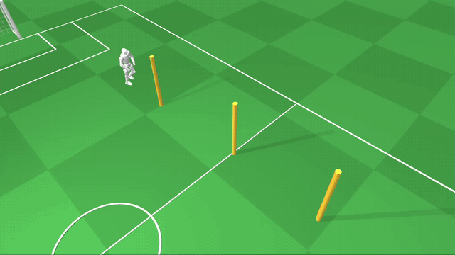

# Q1 SuperMimic · 版本与实验

基于 **MuJoCo + SuperMimic 世界模型**的 Q1 人形机器人三杆绕行项目，记录模仿学习、足底稳定性与训练流程的改进。

`main` 是项目总览和版本导航；可运行源码位于各版本分支。每个版本保留独立视频，便于后续追加比较。

## 版本列表

| 版本 | 相比基线的改动 | 当前结果 | 源码 |
|---|---|---|---|
| Baseline | 原有绕杆策略 | 可完成常规路线，足底滑移较明显 | 本仓库保留展示与指标 |
| reward_footflip · 2100 | 修复摩擦随机化；增加 foot slip／近地落脚辅助惩罚；Actor 定期采样；保存中期模型并记录分项奖励 | 常规路线滑移均速下降 47.3%；五场景 CPU 验收通过 4/5 | [reward_footflip](https://github.com/HZZ2Z/Supermimic_q1_robot/tree/reward_footflip) |

分支名沿用 `reward_footflip`，实际奖励项为 **foot slip**。展示模型为 `run-20261115-160417/checkpoint-002100.pt`，不是最后一次更新。

## 版本演示

两段均裁至 MuJoCo 渲染画面，各保留一次完整 `nominal-01` 推理。保持原录屏速度；录制耗时不同，不用于比较策略运行速度。GIF 为轻量预览，点击可查看高清 MP4 文件。原录像尾段机器人部分走出窗口下缘，已保留，未裁掉该时间段。

### Baseline

[](docs/assets/demos/baseline-nominal-01.mp4)

[高清 MP4](docs/assets/demos/baseline-nominal-01.mp4)

### reward_footflip · checkpoint-002100

[](docs/assets/demos/reward-footflip-20261115-2100.mp4)

[高清 MP4](docs/assets/demos/reward-footflip-20261115-2100.mp4)

## 效果对比

同一 `nominal-01`、CPU、固定初始条件。指标来自原始接触统计，未通过裁掉落脚瞬态来重新计分。

| 指标 | Baseline | 2100 |
|---|---:|---:|
| 足底滑移均速 | 0.1727 m/s | **0.0910 m/s** |
| 滑移速度 >0.05 m/s 的承重时间比例 | 30.48% | **16.83%** |
| 根部 XY RMSE | 2.73 cm | **2.69 cm** |
| 路线完成／摔倒／碰杆 | 完成／无／无 | 完成／无／无 |

2100 在五个固定场景中通过 4/5，左转仍未通过实验滑移门槛，所以没有合格的 `best.pt`。结果体现整组改动，不代表单项奖励的独立效果或实机验证。[完整指标](docs/versions/reward_footflip.json) · [视频剪辑记录](docs/versions/demos.json)

## 获取源码

```bash
git clone --branch reward_footflip https://github.com/HZZ2Z/Supermimic_q1_robot.git
cd Supermimic_q1_robot
```

运行环境为 Linux、Python 3.11、MuJoCo 与 PyTorch；训练使用 CUDA，评估可使用 CPU。安装、warmup 准备和运行命令见[版本 README](https://github.com/HZZ2Z/Supermimic_q1_robot/blob/reward_footflip/README.md)。模型权重、原始录像和训练日志不随 Git 分发。

## 推理

```bash
python -m pole_task.play \
  --checkpoint logs/q1-pole-weaving/run-<timestamp>/best.pt \
  --case nominal-01 --gui --seed 20261103 --loops 5
```

## 版本维护

新增版本以独立分支保存源码和简短说明，在此追加改动、同口径指标与独立演示。基线不因新实验而替换；第三方来源和许可证保留在各源码分支中。

[项目许可证](LICENSE)
