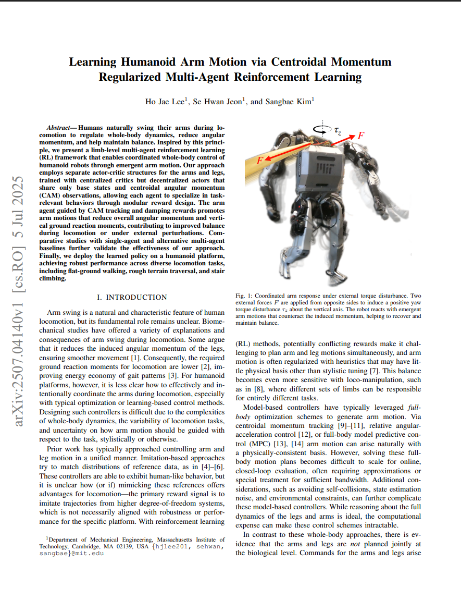

# Supermimic_q1_robot

当前服务器交付分支为 `V2_sicc`，包含 CAM 基础实现与 `lr-replay-v1` 三组学习率/采样诊断。当前实验关闭 CAM，采用 V1 四段起点、每25次 Actor 更新刷新及最近两批 replay；不启用 damping。

- [服务器启动说明](docs/cam/SICC_RUNBOOK.md)
- [三组实验配置、质量门槛与运行命令](docs/cam/LR_REPLAY_RUNBOOK.md)
- [实施记录与验证状态](docs/cam/IMPLEMENTATION_REPORT.md)

训练日志、模型权重、W&B 离线数据及本机诊断产物不随 Git 发布。下文保留原研究目标；当前执行范围以以上运行说明为准。

基于mohismlab提供的supermimic baseline: https://github.com/MohismLab/master_project_q1_robot_soccer

这个分支打算考虑新的强化学习全身协调控制算法，通过引入两个新的奖励：质心角动量跟踪（CAM Tracking）和水平角动量抑制（CAM Damping）来优化 #s形绕杆任务# 策略。

论文链接：https://ieeexplore.ieee.org/document/11177014

github：https://github.com/hojae-io/LearningHumanoidArmMotion-RAL2025-Code

作者：Ho Jae Lee1
, Se Hwan Jeon1
, and Sangbae Kim1

  

# 一、目标

| 优先级 | 目标 | 判断方式 |
|---|---|---|
| 第一 | 稳定完成三杆 S 形绕行 | 完成路线、不碰杆、不摔倒，保持终点和轨迹误差要求 |
| 第二 | 改善全身协调 | 转向时手臂、躯干和双腿合理分担角动量 |
| 第三 | 改善动作质量 | 减少不必要的抖动、足部打滑、躯干摆动和不合理上肢动作 |
| 第四 | 提高抗扰能力 | 在转弯、单脚支撑等阶段受到扰动后继续完成任务 |
