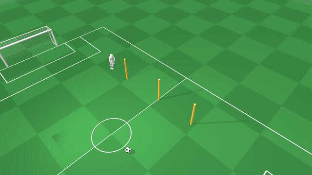

# Q1 SuperMimic · Pole Weaving

**Q1 三杆 S 形绕行 · V1 / B-2400**

[效果与指标](#results) · [仿真复现](#reproduce) · [训练与恢复](#training) · [实验记录](#experiments) · [仓库与文档](#docs) · [常见问题](#troubleshooting)

基于 SuperMimic 的 Q1 机器人运动模仿项目，在 MuJoCo 中完成三杆绕行。训练使用 Actor、世界模型和 Critic；回放由 Actor 驱动 MuJoCo 物理仿真。球和球门是场景元素，不参与绕杆任务的观测、奖励或终止条件。

当前发布模型为 **B 实验第 2400 次更新的 `best.pt`**。归档的 CPU 固定条件评估通过 **5/5 场景**，所有路线完成，无摔倒、碰杆。结果来自单次训练链路和固定评估种子，尚未验证随机扰动、多种子训练和实机表现。

<a id="results"></a>

## 效果与指标

[](docs/assets/demos/V1-B2400-nominal-01.mp4)

[观看 V1 MP4](docs/assets/demos/V1-B2400-nominal-01.mp4) · [版本说明](docs/versions/V1.md) · [五场景原始指标](docs/versions/V1-evaluation.json) · [模型身份与 SHA-256](docs/versions/V1.json)

演示为一次完整的 `nominal-01` CPU 策略回放：675 个控制步、13.5 秒仿真时间，按 50 FPS 导出。视频按仿真时间播放；本地 GUI 的运行速度取决于机器性能。

以下前三项均为 `nominal-01`、CPU、seed `20261103`；最后一项统计五场景正式验收。

| 指标 | Baseline | Foot slip 2100 | **V1 / B-2400** |
|---|---:|---:|---:|
| 全接触滑移均速（m/s） | 0.1727 | 0.0910 | **0.0833** |
| 超速承重时间比例 | 30.48% | 16.83% | **13.58%** |
| 根部 XY 轨迹 RMSE（cm） | 2.73 | 2.69 | **1.65** |
| 五场景正式通过数 | 0/5 | 4/5 | **5/5** |

数值来源：[Baseline / Foot slip 归档](docs/versions/reward_footflip.json)、[V1 评估归档](docs/versions/V1-evaluation.json)。正式验收同时检查路线与足底滑移；走完路线不等于全部指标达标。

<details>
<summary>历史演示：Baseline 与 Foot slip 2100</summary>

### Baseline

[](docs/assets/demos/baseline-nominal-01.mp4)

### Foot slip · 原 2100

[](docs/assets/demos/reward-footflip-20261115-2100.mp4)

点击预览可打开 MP4。旧视频来自录屏，画面速度不用于定量比较。

</details>

<a id="reproduce"></a>

## 仿真复现

本节复现**已发布 V1 权重的策略推理与评估**。所有命令均从仓库根目录执行，使用 Linux / Bash。

| 你要做什么 | 需要准备什么 | 从哪里开始 |
|---|---|---|
| 先看效果 | 仓库中的 GIF / MP4 | [效果与指标](#results) |
| 在本机回放、评估 V1 | Python 环境 + V1 `best.pt`；CPU 即可 | 本节第 1–5 步 |
| 新训练或恢复训练 | 上述环境 + 登记的源 warmup + 可用 CUDA GPU；恢复还需项目 checkpoint | [训练与恢复](#training) |

**权重不随 Git 分发。** 机器人 XML、网格、场景、参考轨迹、配置和带本地修改的 SuperMimic 源码均已包含在仓库中。取得 V1 `best.pt` 后，回放与评估**不需要源 warmup 文件**，也不需要旁边再放一份上游仓库。

### 1. 获取 V1 分支并安装环境

先准备 Git 和 Conda，再执行：

```bash
git clone --branch V1 --single-branch \
  https://github.com/HZZ2Z/Supermimic_q1_robot.git
cd Supermimic_q1_robot

conda env create -f environment.yml
conda activate env_q1
python -m pip install --no-deps -e .
python -m pip check

# 保存本次复现所用的源码版本。
git rev-parse HEAD
```

已有 `env_q1` 时，先激活并核对依赖，不必重复创建。该分支使用以下固定版本，完整清单见 [requirements.txt](requirements.txt)。

| 组件 | 分支版本 |
|---|---|
| Python | 3.11 |
| PyTorch | `2.9.0+cu128` |
| MuJoCo / MuJoCo Warp | `3.17.0` / `3.17.0` |
| NVIDIA Warp | `warp-lang==1.18.0` |
| NumPy | `2.4.6` |

安装后检查包导入与入口：

```bash
python - <<'PY'
import sys
import torch, mujoco, mujoco_warp, warp
import q1_supermimic, pole_task, expert.policy

print("Python:", sys.version.split()[0])
print("PyTorch:", torch.__version__)
print("MuJoCo:", mujoco.__version__)
print("CUDA available:", torch.cuda.is_available())
print("Project packages: OK")
PY

python -m pole_task.play --help
python -m pole_task.evaluate --help
```

`CUDA available: False` 时仍可进行本节的 `--device cpu` 回放与评估。依赖按根目录配置安装；`3rdparty/SuperMimic/README.md` 中的 Python 3.13 / uv 流程属于上游独立项目。本分支已保存所需源码，无需初始化 Git 子模块。更多环境说明见 [docs/setup.md](docs/setup.md)。

### 2. 放置并校验 V1 权重

从已有本地归档或项目维护者处取得 **B-2400 的 `best.pt`**。目前仓库没有发布 V1 权重的 Release 下载附件；课程页中的旧演示权重也不能仅凭文件名认定为 V1。

将下面 `/path/to/V1/best.pt` 替换为实际文件路径：

```bash
mkdir -p "版本记录/V1"
cp /path/to/V1/best.pt "版本记录/V1/best.pt"

sha256sum --check <<'SHA256'
575cc1fd81cf56f1258e61b4e7b2bddc05681922541146a7051a13442b042c05  版本记录/V1/best.pt
SHA256
```

应输出 `版本记录/V1/best.pt: OK`。如果文件已经在该位置，跳过复制，只做校验。模型身份以 [V1.json](docs/versions/V1.json) 为准；本地 `版本记录/` 和 `*.pt` 已加入 Git 忽略列表。

### 3. 先运行一次无界面回放

```bash
python -m pole_task.play \
  --checkpoint "版本记录/V1/best.pt" \
  --case nominal-01 --device cpu --seed 20261103 --loops 1 \
  --output outputs/V1-playback/nominal-01.json
```

这个命令执行真实策略推理和 MuJoCo 物理步进，不打开窗口。完整回放会输出路线、碰撞、摔倒、轨迹误差和滑移指标。对于归档 V1，预期 `route_completed: true`、`fall: false`、`pole_collision: false`、`success: true`。

`--output` 指定的是 **JSON 文件**；父目录还会生成运行用 XML 和 `references/`。同一路径再次运行会覆盖结果，比较多个模型时请分别指定输出目录。

### 4. 打开 MuJoCo 窗口

在有图形桌面的终端中执行：

```bash
python -m pole_task.play \
  --checkpoint "版本记录/V1/best.pt" \
  --case nominal-01 --device cpu --seed 20261103 --loops 1 --gui \
  --output outputs/V1-gui/nominal-01.json
```

让回合自然结束后再检查结果；提前关闭窗口会截断回合。SSH 无显示会话可先使用第 3 步的无界面命令。当前 GUI 没有按墙钟时间限速，因此窗口运行耗时不一定是视频中的 13.5 秒。

| `--case` | 用途 |
|---|---|
| `nominal-01` | 主三杆绕行路线，也是首页演示场景 |
| `eval-01` | 留出的评估路线，不进入训练批次 |
| `straight` | 直行保持测试 |
| `left_turn` | 左转保持测试 |
| `right_turn` | 右转保持测试 |

把 `--case nominal-01` 换成表中的名称即可切换场景；`--loops 5` 可连续运行五次，每轮种子递增。当前回放关闭动力学随机化和动作噪声，循环次数不能替代扰动鲁棒性实验。

### 5. 复测五场景并读取结果

使用与归档相同的 CPU 入口和起始种子：

```bash
python -m pole_task.evaluate \
  --checkpoint "版本记录/V1/best.pt" \
  --device cpu --seed 20261103 \
  --output outputs/V1-evaluation/evaluation.json
```

入口自动评估 `nominal-01`、`eval-01`、`straight`、`left_turn`、`right_turn`，每个场景内部使用递增种子，无需分别执行五条命令。读取整体与逐场景结果：

```bash
python - <<'PY'
import json
from pathlib import Path

report = json.loads(Path("outputs/V1-evaluation/evaluation.json").read_text())
cases = report["cases"]
print("Overall success:", report["success"])
print("Passed cases:", sum(row["success"] for row in cases.values()), "/", len(cases))
for name, row in cases.items():
    slip = row["foot_slip_mean_m_s"]
    print(name, "success=", row["success"],
          "RMSE(cm)=", round(row["root_xy_rmse_m"] * 100, 2),
          "slip(m/s)=", round(slip, 4) if slip is not None else "N/A")
PY
```

以下是**仓库已有的 V1 归档值**，用于核对本机结果；不应把归档记录当作本机已经完成的测试。

| 场景 | 正式通过 | 根部 XY RMSE（cm） | 全接触滑移均速（m/s） | 超速承重时间比例 |
|---|:---:|---:|---:|---:|
| `nominal-01` | PASS | 1.65 | 0.0833 | 13.58% |
| `eval-01` | PASS | 1.67 | 0.0803 | 14.12% |
| `straight` | PASS | 1.53 | 0.0714 | 14.11% |
| `left_turn` | PASS | 1.66 | 0.0865 | 14.64% |
| `right_turn` | PASS | 2.33 | 0.0707 | 13.74% |

同时检查顶层 `success` 和五个场景的 `success`。正式验收包含路线条件及滑移均速 ≤ 0.10 m/s、超速承重时间比例 ≤ 20% 等条件，具体定义见 [奖励与验收说明](docs/foot-contact-rewards.md)。跨硬件或软件环境出现差异时，先核对模型哈希、源码版本、依赖、设备与种子。

`play` / `evaluate` 正常完成且通过时返回 `0`，指标未通过时返回 `1`；缺文件、依赖或权重格式错误会另行报错。两者使用分支内的默认任务配置，没有 `--config` 参数。`--output` 不会生成 MP4，当前入口也没有 `--video`、`--fps` 或 `--speed` 参数。

<details>
<summary>可选：五场景验收 + nominal 20 次重复检查</summary>

```bash
python -m pole_task.acceptance \
  --checkpoint "版本记录/V1/best.pt" \
  --device cpu --seed 20261103 --trials 20 \
  --output outputs/V1-acceptance/acceptance.json
```

这是额外的固定条件重复检查，不等同于 20 次独立训练或随机扰动评估。首页的 5/5 结论对应前面的五场景归档。

</details>

<a id="training"></a>

## 训练与恢复

已有 V1 权重的仿真复现到上一节即可完成。本节用于继续开发训练，默认设备为 `cuda:0`。新训练从登记的源 warmup 初始化，再执行 **2000 次冻结 Actor 的 warmup + 500 次 Actor 更新**；它不保证产生与归档 V1 完全相同的权重。

### 准备源 warmup 并检查硬件

从[课程说明中的 warmup 下载入口](courses/pole-weaving/README.zh-CN.md#首次体验前)或项目维护者处取得任务 7.7 的 `checkpoint_2000.pt`，按[资产说明](docs/pole-weaving.md#所需资产)放置：

```bash
mkdir -p courses/pole-weaving/pole_task/assets/checkpoints
cp /path/to/checkpoint_2000.pt \
  courses/pole-weaving/pole_task/assets/checkpoints/warmup-checkpoint_2000.pt

sha256sum --check <<'SHA256'
b27dabb8c1f1698b669f7dcb59b5b08f1655a7a43f85b57b2686f76096a224f5  courses/pole-weaving/pole_task/assets/checkpoints/warmup-checkpoint_2000.pt
SHA256

python -m pole_task.preflight \
  --config courses/pole-weaving/pole_task/config.json
```

预检查验证资产、warmup 严格加载、训练配方及硬件，不创建训练目录。确认 `training_ready`、`initialization.available`、`hardware.ready` 均为 `true`，且命令返回 `0`，再开始训练。默认要求至少 4 GB 空闲显存；这是预检查阈值，实际显存占用取决于运行配置。

### 冒烟运行与新训练

```bash
# 一次更新：检查训练链路和 checkpoint 写出，不用于判断最终效果。
python -u -m pole_task.training \
  --config courses/pole-weaving/pole_task/config.json \
  --max-updates 1 --run-name V1-smoke

# 正式新训练：累计更新上限 2500。
python -u -m pole_task.training \
  --config courses/pole-weaving/pole_task/config.json \
  --max-updates 2500 --run-name V1-new-run
```

每条命令创建独立运行目录；同名目录已存在时会拒绝覆盖，再次运行请更换 `--run-name`。默认位置为 `logs/q1-pole-weaving/<run-name>/`，包括配置、身份记录、JSONL 指标和 `latest.pt`；进入 Actor 阶段后按保存间隔生成编号 checkpoint。只有通过正式验收才会生成 `best.pt`；一次更新的 smoke 不要求通过任务验收。

### 恢复已有 checkpoint

恢复时配置身份必须与原训练一致。V1 的原 B 配置与当前默认配置的输出目录不同，不能互换用于恢复校验。

| checkpoint 来源 | 恢复时的 `--config` |
|---|---|
| V1 / 原 B 实验 | `experiments/reward-sampling/B.json` |
| 原 A 实验 | `experiments/reward-sampling/A.json` |
| V1 之前的旧主线 | `experiments/reward-sampling/pre-V1-main.json` |
| 按本页默认配置新训练 | `courses/pole-weaving/pole_task/config.json`，保持该次运行配置不变 |

<details>
<summary>V1 从 2400 恢复到累计 2500 的命令示例</summary>

```bash
python -m pole_task.preflight --config experiments/reward-sampling/B.json

python -u -m pole_task.training \
  --config experiments/reward-sampling/B.json \
  --resume-checkpoint "版本记录/V1/best.pt" \
  --max-updates 2500 --run-name V1-resume2400-to2500
```

`--max-updates 2500` 是累计更新终点，即从 2400 再执行至多 100 次更新，并非额外训练 2500 次。B 配置将新运行写入 `logs/q1-pole-weaving/experiment-B/<run-name>/`；保持原配置文件不变，用 run name 区分实验。

此处展示恢复入口。历史 B-2500 的 CPU 指标出现退化，不能因更新次数更多就替换发布用的 B-2400。训练仍受环境步数预算与提前停止条件约束。

</details>

归档 V1 的训练链路为 `B-stratified-to1000` → `B-stratified-from1000-to2200` → `B2200_2500`，最后一段选中 2400。恢复会重建 RNG / replay，因此单次不中断的新训练不构成该 checkpoint 的逐位复现。完整记录见 [V1 版本说明](docs/versions/V1.md)、[训练与恢复细节](docs/pole-weaving.md)和 [A/B 日志](logs/README.md)。

<a id="experiments"></a>

## 实验记录与选模依据

**Foot slip**（历史分支名 `reward_footflip`）修复摩擦随机化，沿用原奖励入口加入足底滑移与近地落脚速度惩罚，并将实际滑移纳入评估与选模。

**V1** 在此基础上采用 B 的 Actor 四段轮换、段内随机起点；warmup 仍均匀随机。Actor replay 保留最近两批，每 25 次刷新与评估、每 50 次保存编号 checkpoint，并补充分场景采样与接触分阶段日志，修复恢复阶段边界和提前停止计数。奖励权重与正式验收门槛保持不变。

### A/B 对照

两组均从登记源 warmup 初始化，不从旧 2100 微调，目标是改善左转连续支撑与重新承重，同时保住其他场景。

| 实验 | Actor 起点采样 | 滑移权重 | 训练过程 |
|---|---|---:|---|
| A | 均匀随机 | 0.05 | 到 1000 恢复至 2200，随后续至 2500 |
| B | 四段轮换、段内随机 | 0.05 | 同样在 1000 和 2200 恢复，最终至 2500 |
| C 候选 | 同 B | 0.075 / 0.10 | 离线筛选未通过，没有启动训练 |

| 共同参数 | 设置 |
|---|---|
| 训练种子 | `20261103` |
| Actor / 世界模型 / Critic 基础学习率 | `1e-5` / `1e-4` / `1e-4` |
| 想象长度；模型 / 策略 batch | `32`；`512` / `512` |
| 每次更新的拟合 | 世界模型 10 批；Critic 5 epochs × 4 minibatches |
| 每批采集回合 | nominal 4；straight / left_turn / right_turn 各 2 |
| 滑移 / 落脚 / 手臂奖励权重 | `0.05` / `0.02` / `0.05` |

当前源兼容流程的训练配方由 `source_training` 配置解析，不能用配置文件中保留的旧顶层学习率、horizon、batch 字段推断生效参数。详见 [A/B 实验配置与说明](experiments/reward-sampling/README.md)。

B 的四段起点覆盖已逐个核验；左转四个困难时段的有效候选窗口空缺从 A 的 4/32 减至 B 的 1/32，但 B 实际左转策略样本数减少 6.6%。覆盖更均匀不代表左转训练量更多。

### 为什么发布 2400，而不是最后的 2500

以下保留历史 CPU 对照记录，使用同一评估入口和起始 seed `20261103`，不混用 GPU 训练内评估。连续承重统计剔除重新承重前 10 ms，触地 / 离地窗口为 40 ms；正式验收仍使用完整接触统计。

| 模型 | 左转连续均速（m/s） | 左转再承重积分（m） | 五场景正式通过 |
|---|---:|---:|---:|
| 原 Foot slip 2100 | 0.02270 | 0.4693 | 4/5 |
| A-2200 | 0.01765 | 0.2626 | 3/5 |
| B-2200 | 0.01832 | 0.2530 | 2/5 |
| **V1 / B-2400** | **0.01434** | **0.2160** | **5/5** |
| B-2500 | 0.01773 | 0.3347 | 2/5 |

B-2400 获得更均衡的 CPU 结果。`best.pt` 实际记录为 2400，与编号 checkpoint 的三个网络逐张量一致；2325、2425 也曾通过训练内门槛，但选模分数未超过最终 2400。2400 以后 loss 继续下降，2500 的再承重积分却在左转、nominal、右转分别增加约 55%、120%、105%，因此本版保留中期 best。

V1 与原 2100 的原始评估 JSON 已随仓库发布。A-2200、B-2200、B-2500 的完整 CPU 分析仍属于本地归档；公开的 A/B 训练日志不能代替这些 CPU 原始评估。

<details>
<summary>展开逐场景接触对比与已知退化</summary>

| 场景 | V1 连续均速（m/s） | V1 再承重积分（m） | 相对原 2100：连续 / 再承重 |
|---|---:|---:|---:|
| 左转 | 0.01434 | 0.2160 | −36.9% / −54.0% |
| nominal | 0.01373 | 0.2369 | −19.8% / −32.3% |
| straight | 0.01124 | 0.0655 | −26.9% / −5.0% |
| 右转 | 0.01426 | 0.1915 | −5.6% / −7.6% |
| eval-01 | 0.01419 | 0.1946 | −9.0% / −51.5% |

相对 B-2200，V1 左转触地积分下降 34.9%、连续均速下降 21.7%、再承重积分下降 14.6%，路线 RMSE 从 2.74 降至 1.66 cm；但直行再承重积分增加 13.6%。相对 A-2200，左转触地积分基本相同，触地均速仍高 11.3%。

左转、直行总承重时间比原 2100 少约 7%。按承重秒归一化后，左转再承重积分仍低 50.4%，直行则略高 2.1%；右转再承重次数从 92 增至 106。V1 是当前综合候选，不代表所有接触分项均无退化，也尚未验证多种子训练、随机扰动或实机。

</details>

<a id="docs"></a>

## 仓库与文档

| 位置 | 作用 |
|---|---|
| [`courses/pole-weaving/pole_task/`](courses/pole-weaving/pole_task/) | 绕杆任务、配置，以及 play / evaluate / acceptance / training 入口 |
| [`pole_task/inference.py`](courses/pole-weaving/pole_task/inference.py) | checkpoint 身份校验与 Actor 加载 |
| [`pole_task/source_runtime.py`](courses/pole-weaving/pole_task/source_runtime.py)、[`source_environment.py`](courses/pole-weaving/pole_task/source_environment.py) | 策略回合执行与 MuJoCo 环境 |
| [`pole_task/source_training.py`](courses/pole-weaving/pole_task/source_training.py) | 当前 Actor、世界模型、Critic 训练流程 |
| [`shared/q1-mujoco/resources/`](shared/q1-mujoco/resources/) | Q1 模型、网格和场景资源 |
| [`3rdparty/SuperMimic/`](3rdparty/SuperMimic/) | 随分支保存的 SuperMimic 源码与本地修改 |
| [`experiments/reward-sampling/`](experiments/reward-sampling/) | A/B 配置及旧主线恢复配置 |
| [`docs/versions/`](docs/versions/)、[`docs/assets/demos/`](docs/assets/demos/) | 可分享的版本记录、指标与精选演示 |
| [`logs/`](logs/README.md) | 已公开且脱敏的 A/B 各三段训练日志；新训练也默认写入此处 |
| `版本记录/`、`outputs/` | 本机权重与完整归档、复现输出；不随 Git 分发 |

A/B 六段精选日志直接位于 `logs/q1-pole-weaving/`，不再嵌套 `experiment-A/B`；checkpoint 内的历史路径与原配置保持不变。旧试验和 smoke 记录迁至本地 `版本记录/历史训练归档/`，本机迁移映射为 `版本记录/训练路径迁移.json`。

**进一步阅读**

[环境搭建](docs/setup.md) · [资产、训练与恢复](docs/pole-weaving.md) · [奖励与验收](docs/foot-contact-rewards.md) · [课程中文说明](courses/pole-weaving/README.zh-CN.md) · [Course README (English)](courses/pole-weaving/README.md) · [程序流程](docs/程序流程.md) · [开发日志](docs/开发日志.md) · [许可证](LICENSE)

<a id="troubleshooting"></a>

## 常见问题

| 现象 | 检查与处理 |
|---|---|
| `No module named pole_task` 或项目包无法导入 | 激活 `env_q1`，在仓库根目录执行 `python -m pip install --no-deps -e .`；确认运行的是该环境的 Python。 |
| `Pole checkpoint not found` | Git 不附带权重；先取得 V1 `best.pt`，核对实际路径并完成 SHA-256 校验。 |
| checkpoint 格式、profile 或身份不匹配 | 使用本项目 V1 绕杆 checkpoint；源 warmup、源任务最终 Actor 和旧足球专家权重不能直接作为 V1 回放权重。 |
| 哈希不一致或恢复时配置不匹配 | 核对文件与模型来源；V1 恢复使用原 `B.json`，其他模型使用各自原配置。保留已有身份校验。 |
| CUDA 不可用 | 先使用 `--device cpu` 回放 / 评估；GPU 训练需通过独立 `pole_task.preflight`，并确认 `hardware.ready: true`。 |
| GLFW / 显示连接错误 | 先去掉 `--gui` 运行无界面评估；GUI 需要可用的图形桌面与 OpenGL 显示环境。 |
| 提示初始化 SuperMimic 子模块 | 当前分支已将其作为普通目录保存。检查 `3rdparty/SuperMimic/src/supermimic/algorithm.py` 是否存在，并恢复同一 V1 版本的完整目录；代码中该错误提示仍有历史表述。 |
| `--output result.mp4` 没有得到视频 | `--output` 写入 JSON，与扩展名无关；现有 MP4 在 [演示目录](docs/assets/demos/)，当前绕杆 CLI 未提供录像参数。 |
| 新训练没有 `best.pt` | 检查 `latest.pt`、编号 checkpoint 和指标；只有通过验收才会产生 best，一次更新的 smoke 不保证达标。 |

<details>
<summary>开发者：运行现有测试集</summary>

```bash
conda activate env_q1
python -m pip install -r requirements-test.txt
python -m pip install --no-deps -e .
python -m pip check
python -m pytest
```

测试覆盖中包含源 warmup 与真实 CUDA / Warp 条件；缺少资产或 GPU 时的跳过不能视为完整验证通过。测试与运行还需要 SuperMimic 动作缓存目录 `~/.cache/supermimic/motions` 可写。具体条件见 [环境指南](docs/setup.md#测试与常见问题)。

</details>
