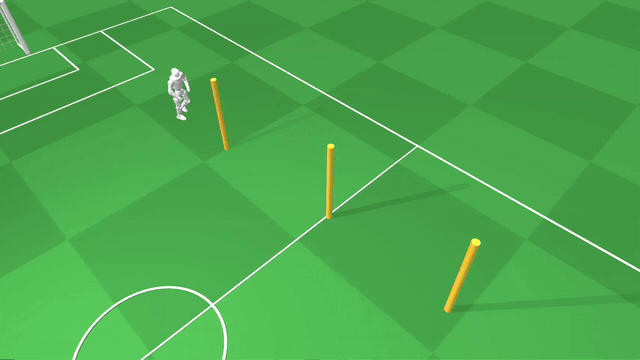

# Q1 Robot · 版本对比

基于SuperMimic的Q1三杆绕行实验。main用于展示与版本索引；源码、训练方法和实验报告见各版本分支。

## 版本记录

|版本|主要优化|CPU五场景通过|入口|
|---|---|---:|---|
|Baseline|原有模仿与路线跟踪|0/5（按后加滑移门槛复评）|原始对照|
|Foot slip · 2100|修复摩擦随机化，增加足底滑移／落脚速度惩罚，加入滑移选模|4/5|[源码与说明](https://github.com/HZZ2Z/Supermimic_q1_robot/tree/reward_footflip)|
|**V1 · B-2400**|Actor四段采样、最近两批replay，完善采样／接触诊断与恢复逻辑|**5/5**|[源码与实验报告](https://github.com/HZZ2Z/Supermimic_q1_robot/tree/V1)|

V1采用B实验的2400检查点，不是最后2500模型；奖励权重和正式门槛保持不变。

## 演示

### Baseline

### Foot slip · 原2100

### V1 · B-2400

点击图片查看完整MP4。V1是一次13.5秒CPU仿真回放，旧版为录屏，视觉播放速度不用于定量比较。旧录屏尾段机器人部分出画，已保留完整时段。

## 同条件对比

nominal-01，CPU，seed=20261103：

|指标|Baseline|Foot slip 2100|V1|
|---|---:|---:|---:|
|滑移均速 m/s|0.1727|0.0910|**0.0833**|
|超速承重比例|30.48%|16.83%|**13.58%**|
|路线XY RMSE cm|2.73|2.69|**1.65**|

V1相对原2100的左转连续承重均速下降36.9%、再承重积分下降54.0%。但承重时间也有变化，部分接触分项仍存在取舍；5/5仅代表本轮固定仿真验收，不代表实机安全或多种子鲁棒性。

[原2100记录](docs/versions/reward_footflip.json) · [V1身份与结果](docs/versions/V1.json) · [V1五场景指标](docs/versions/V1-evaluation.json)

权重与原始训练日志不随Git分发。训练、恢复、配置和完整实验分析请查看[V1分支README](https://github.com/HZZ2Z/Supermimic_q1_robot/blob/V1/README.md)。

[许可证](LICENSE)
