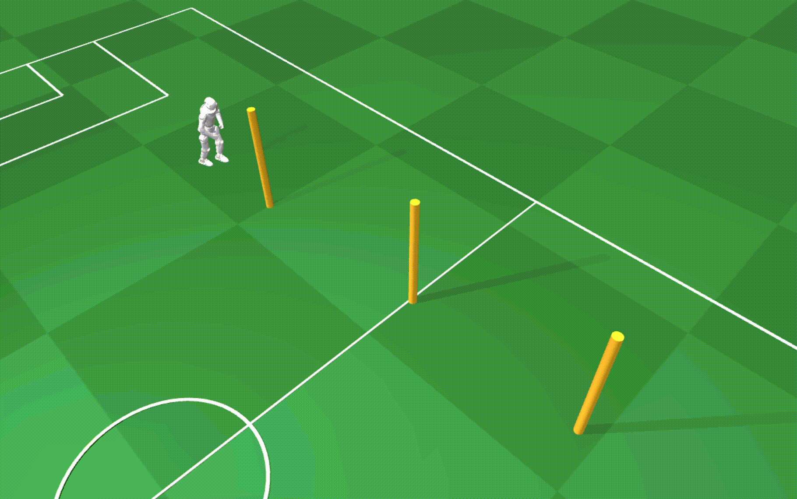

# S-shaped Pole Weaving

The mainline now defaults to V1 stratified Actor sampling. V1 selects B-2400; see the [version and resume guide](../../docs/versions/V1.md). The older demo below remains a historical reference. Resume historical checkpoints with their original config.

English | [简体中文](README.zh-CN.md)

This course provides a Q1 baseline for weaving through a three-pole S-shaped course using the SuperMimic world-model framework. It covers the task environment, observation design, and reward design, and supports baseline reproduction and policy improvement.



## Before You Start

Set up the environment using the [shared environment setup guide](../../docs/setup.md) (currently in Chinese). Training defaults to `cuda:0` and requires an NVIDIA GPU with at least 4 GB of free memory. Evaluation and demonstrations default to CPU. Training requires the task 7.7 warmup checkpoint; download the [pole warmup checkpoint](https://drive.google.com/file/d/1PmM1NoD09gKIwzqlj3-rCeQRdffVutjJ/view?usp=sharing) and register it at the exact path described in the [asset and reproduction guide](../../docs/pole-weaving.md) (currently in Chinese). It cannot be replaced with the soccer expert checkpoint. A separate [trained pole demonstration checkpoint](https://drive.google.com/file/d/1bd2CDBAJr7fV_5Tpy5-2hrq3ZZIyg3so/view?usp=sharing) is available for playback; course models are not included in Git.

`3rdparty/SuperMimic` is bundled as source in this branch, including local reward changes; no submodule initialization or separate upstream clone is needed. The source robot model, route data, and training configuration snapshots are maintained in this repository.

The baseline reproduces the three-pole route from source task 7.7 in the repository's soccer-field scene. It uses task-specific observations, rewards, reset and termination conditions, and checkpoint format. For compatibility details, asset paths, SHA-256 hashes, data splits, and full reproduction commands, see the [asset and reproduction guide](../../docs/pole-weaving.md) (currently in Chinese).

## Quick Start

Run these commands from the repository root. Before training, download the [warmup checkpoint](https://drive.google.com/file/d/1PmM1NoD09gKIwzqlj3-rCeQRdffVutjJ/view?usp=sharing) and register it at the path shown in the [asset and reproduction guide](../../docs/pole-weaving.md). The smoke run performs one update and writes `latest.pt` for checking model loading and headless playback; it is not intended to train a policy that meets task metrics. The model is saved under `logs/q1-pole-weaving/run-<timestamp>/latest.pt`; `best.pt` is produced only after all acceptance gates pass; numbered checkpoints retain intermediate candidates. Evaluation and playback do not require the warmup file.

```bash
pip install gdown

mkdir -p courses/pole-weaving/pole_task/assets/checkpoints/
gdown 1PmM1NoD09gKIwzqlj3-rCeQRdffVutjJ -O courses/pole-weaving/pole_task/assets/checkpoints/

# Read-only preflight: hashes data and source assets, strictly loads the warmup checkpoint,
# parses the source configuration, and checks hardware. Does not create a run directory.
python -m pole_task.training --preflight-only --config courses/pole-weaving/pole_task/config.json

# Short smoke training: performs one update and writes latest.pt for playback.
python -m pole_task.training --config courses/pole-weaving/pole_task/config.json --max-updates 1

# Train this project's pole-weaving configuration (2,000 warmup + 500 Actor updates).
python -m pole_task.training --config courses/pole-weaving/pole_task/config.json

# Resume a run from this project.
python -m pole_task.training --config courses/pole-weaving/pole_task/config.json \
  --resume-checkpoint logs/q1-pole-weaving/run-<timestamp>/latest.pt

# Headless evaluation, full acceptance checks, and playback.
# Supports only pole-weaving checkpoints from this project.
python -m pole_task.evaluate \
  --checkpoint logs/q1-pole-weaving/run-<timestamp>/best.pt --device cpu
python -m pole_task.acceptance \
  --checkpoint logs/q1-pole-weaving/run-<timestamp>/best.pt --device cpu
python -m pole_task.play \
  --checkpoint logs/q1-pole-weaving/run-<timestamp>/best.pt --case nominal-01

# Play five times; the random seed increments from 20261103.
# -<timestamp> need to be replace with real name
python -m pole_task.play \
  --checkpoint logs/q1-pole-weaving/run-<timestamp>/best.pt \
  --case nominal-01 --gui --seed 20261103 --loops 5
```

The default output directory is `logs/q1-pole-weaving/`. `python -m q1_supermimic.train` also selects pole weaving by default; `--check` runs preflight and `--resume` forwards the checkpoint for recovery. The repository retains legacy pole adapters and their policy architecture/configuration dependencies, while the documented training and playback commands use the source-compatible pole pipeline.

## Headless Demonstration

To play the provided trained model without running training, download the [pole demonstration checkpoint](https://drive.google.com/file/d/1bd2CDBAJr7fV_5Tpy5-2hrq3ZZIyg3so/view?usp=sharing) and save it as `logs/q1-pole-weaving/pole-demo.pt`, then run:

```bash
python -m pole_task.play \
  --checkpoint logs/q1-pole-weaving/pole-demo.pt \
  --case nominal-01 --device cpu
```

You can also use `latest.pt` from a short smoke run to run the complete `nominal-01` route and save demonstration results. Full training is not required:

```bash
python -m pole_task.play \
  --checkpoint logs/q1-pole-weaving/run-<timestamp>/latest.pt \
  --case nominal-01 --device cpu
```

Course models are not included in the repository. After changing the algorithm, keep a separate training output directory and evaluate with the same task configuration.
